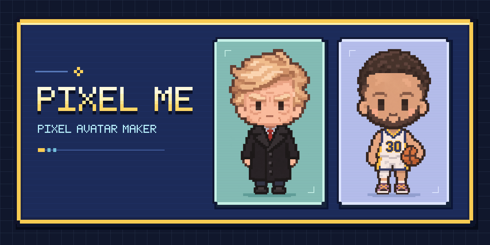

# Pixel Me Arcade

Create and edit full-body pixel avatars in a retro arcade cabinet. Start with a written prompt, a single reference photo, or both.

## Features

- Generate a character or edit an existing avatar with a new instruction.
- Compare the original and edited avatar in the preview screen.
- Save a PNG with a transparent, white, or custom background.
- Switch between blue, teal, and red cabinets.

## Run locally

Use Node.js 22.13 or newer.

~~~sh
npm ci
npm run dev
~~~

Open the localhost URL printed in the terminal. The built-in freckle demo and PNG export work without an API key.

For live generation, open **Image access**, enter your OpenAI API key, and press **Create**. Reference photos support PNG, JPEG, and WebP up to 8 MB.

## Image access and privacy

The app keeps a visitor's key in the current browser tab. Generation sends the key, prompt, and any reference images to the app server, which forwards the request to the [OpenAI Image API](https://developers.openai.com/api/docs/guides/image-generation). Select **Clear key** or close the tab to clear it.

A ChatGPT Sites deployment can also offer ChatGPT sign-in when it provides an authenticated gateway and its operator sets an OpenAI API key as a server-side runtime secret.

## Build

~~~sh
npm run typecheck
npm run build
npm start
~~~

The build runs with Vinext and Cloudflare Workers. The local start command serves the built Worker, including the image generation route.
